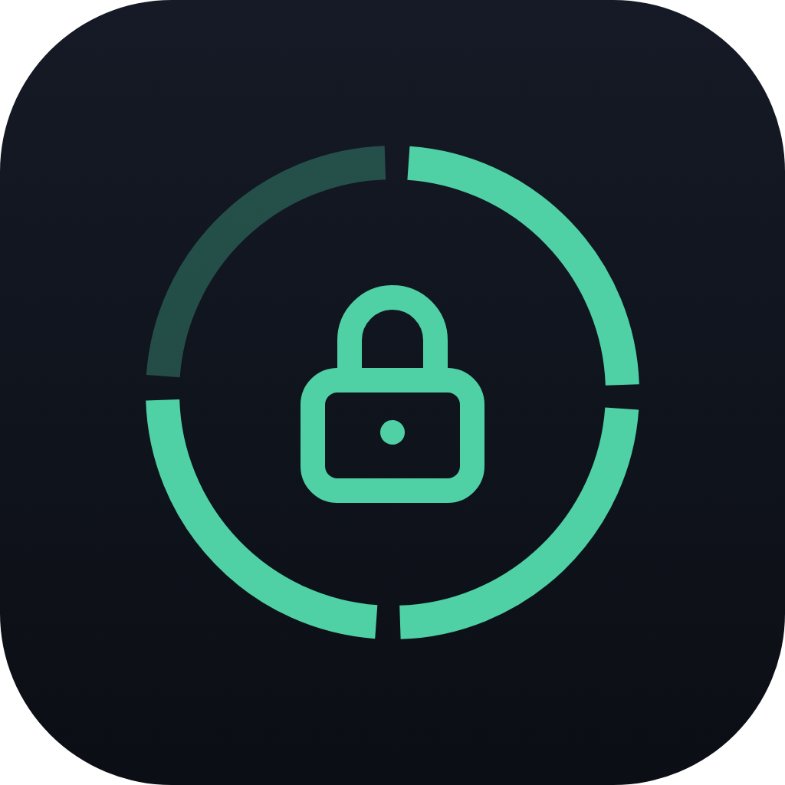

<p align="center">
  
</p>

<h1 align="center">Locked</h1>

Focus mode with **multiple schedules**. Each schedule locks its own set of apps, starts on its own, and runs a Pomodoro while it's active: 25 minutes of focus, 5-minute break (apps unlocked), repeat until the end time.

## Features
- Unlimited schedules: name, days, start/end (overnight supported), per-schedule app list, on/off toggle
- Auto-start at the scheduled time, with a 1-minute heads-up notification
- Pomodoro 25/5 with a live countdown notification; apps unlock during breaks
- Overlapping schedules: locks the union of active apps, session lasts until the latest end
- "Start now" quick session with a chosen duration
- Always-allowed apps (dialer, emergency, messages, clock, Locked itself)
- End early: hold 3 seconds, then solve a math puzzle or type a phrase. Early exits are counted
- Optional: block Settings/app installers during focus; hold back locked apps' notifications until the break
- Survives reboots and clock changes (state is computed from the clock, not stored as a flag)

## Build
```bash
./builder.sh            # debug APK -> dist/locked-debug.apk
./builder.sh install    # build + adb install
./builder.sh release    # unsigned release APK
```
`builder.sh` installs JDK 17 and the Android SDK if missing, writes `local.properties`, bootstraps the Gradle wrapper, and builds.

## Setup on the phone
1. Open Locked → **Finish setup** → enable the **accessibility service** (needed to see which app is open).
   On a sideloaded build Android may grey it out: App info → ⋮ → **Allow restricted settings**, then try again.
2. Allow notifications and exact alarms.
3. Optional: grant notification access (Settings) to silence locked apps' notifications during focus.

## How it works
| Piece | File |
|---|---|
| Session state computed from clock + schedules | `Engine.kt` |
| Detects the foreground app, launches the block screen | `LockAccessibilityService.kt` |
| Block screen + end-early flow | `BlockActivity.kt`, `EndEarly.kt` |
| Boundary alarms, reboot recovery | `Engine.kt`, `Receivers.kt` |
| Optional notification snoozing | `LockNotificationListener.kt` |
| Storage (SharedPreferences, JSON) | `Store.kt` |

Kotlin · Jetpack Compose · min SDK 26 · target SDK 34 · no third-party dependencies beyond AndroidX/Compose.

## Privacy
No network access, no analytics. The accessibility service only reads the foreground package name, never screen content. All data stays on the device.

## License
MIT
